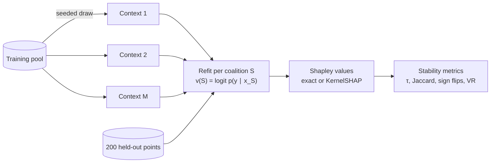

<div align="center">



<h3>Context-induced explanation instability in tabular foundation models</h3>

[](https://www.python.org/)
[](https://pytorch.org/)
[](LICENSE)
[](#project-status)

[Overview](#overview) •
[Method](#method) •
[Installation](#installation) •
[Usage](#usage) •
[Configuration](#configuration) •
[Outputs](#outputs) •
[Pilot results](#pilot-results) •
[References](#references)

</div>

---

## Overview

Tabular foundation models (TFMs) such as **TabPFN** and **TabICL** make predictions by in-context learning: the network is frozen, and the training rows are passed in as context at inference time. Any explanation of a TFM prediction is therefore an explanation of the pair *(network, context)*. If the context changes, the explanation can change too, even when the predictions barely move.

`tfmxai` is a research codebase that measures this effect. For each dataset it:

1. draws many contexts of size *k* from a fixed training pool,
2. computes Shapley-value attributions for a fixed set of held-out points under each context, and
3. measures how much those attributions agree across contexts. Model randomness and estimator noise are separated out with a nested replicate design.

The same pipeline runs on XGBoost and logistic regression trained on **exactly the same row sets**. That makes it possible to ask whether TFM explanations are more or less stable than classical models at matched data size.

> [!NOTE]
> This is an active research project. The main experiment grid is running. The numbers below come from the pilot and are preliminary.

## Features

| Area | What is implemented |
|---|---|
| **Models** | TabPFN v2 and v2.5 (`tabpfn`), TabICLv2 (`tabicl`), XGBoost, Random Forest and L2 logistic regression behind one factory (`models.py`) |
| **Value function** | A single refit value function for every model: v(S) = logit p(true class \| x_S), refit on the context restricted to features S (`values.py`) |
| **Shapley estimation** | Exact enumeration for small *d*; paired KernelSHAP with an exact efficiency constraint otherwise. Coalition evaluations are shared across all explained points (`shapley.py`) |
| **Data** | OpenML classification datasets with a stratified pool/explain split; synthetic logistic data with a closed-form oracle value function for ground-truth Shapley values (`data.py`) |
| **Contexts** | Deterministic uniform or stratified samplers seeded by (dataset, k, context id), so every model sees identical rows (`contexts.py`) |
| **Metrics** | Local and global Kendall τ, top-3 Jaccard, sign-flip rate, a context/seed/explainer variance decomposition, prediction-stability controls and oracle error (`metrics.py`) |
| **Experiment runner** | Resumable grid runner with atomic writes, context-major scheduling, a time limit (`--hours`) and sleep prevention on Windows (`run.py`) |
| **Tooling** | Cost estimation before running (`timing.py`), per-cell summaries (`summarize.py`), a Windows-compatible TabPFN license login (`scripts/tabpfn_login.py`) |

## Method



**Value function.** For a coalition of features $S$, the model is refit on the context with only the columns in $S$, and

$$
v(S) = \operatorname{logit}\, p\!\left(y_{\text{true}} \mid x_S;\ \text{context}_S\right), \qquad v(\varnothing) = \operatorname{logit}\, \hat\pi_{y}^{\text{context}}
$$

where $\hat\pi$ is the Laplace-smoothed class prior of the context. For a TFM, "refit" is a new in-context forward pass. The definition is identical for every model, so stability differences come from the models rather than from the explainer.

**Shapley estimation.** With $d \le 8$ (main grid), all $2^d$ coalitions are evaluated and Shapley values are computed exactly. Otherwise, paired KernelSHAP is used with a 512-coalition budget: the empty and full coalitions, plus complement pairs whose sizes follow the Shapley kernel. The efficiency constraint is enforced exactly.

**Variance decomposition.** Every context gets one run. The first `replicate_contexts` contexts are rerun with a second model seed (same coalitions) and, for KernelSHAP, a second explainer seed. This separates

| Component | Meaning |
|---|---|
| `var_context` | variation across context draws, which is the effect under study |
| `var_seed` | the model's own randomness, e.g. TFM ensemble shuffles |
| `var_explainer` | KernelSHAP sampling noise |

and gives the variance ratio `VR = var_context / var_seed`.

The full protocol, hypotheses and planned analyses are in [`docs/study-design.md`](docs/study-design.md).

## Project structure

```text
tfm-xai-stability/
├── configs/
│   ├── main.yaml                 # main experiment grid
│   ├── pilot.yaml                # 3-dataset pilot
│   ├── synthetic.yaml            # oracle experiments on synthetic data
│   ├── datasets.yaml             # 16 OpenML datasets
│   ├── datasets_pilot.yaml
│   └── datasets_synthetic.yaml
├── docs/
│   ├── assets/banner.svg
│   └── study-design.md           # research protocol and hypotheses
├── scripts/
│   └── tabpfn_login.py           # one-time TabPFN-2.5 license login (Windows-safe)
├── src/tfmxai/
│   ├── __init__.py               # loads .env before model packages read their caches
│   ├── data.py                   # OpenML + synthetic datasets, oracle value function
│   ├── contexts.py               # seeded context samplers
│   ├── models.py                 # model factory (TFMs and baselines)
│   ├── values.py                 # refit coalition value function
│   ├── shapley.py                # exact and paired KernelSHAP estimators
│   ├── metrics.py                # stability metrics and variance components
│   ├── run.py                    # resumable grid runner (CLI)
│   ├── summarize.py              # per-cell summary table (CLI)
│   └── timing.py                 # cost estimate before a run (CLI)
├── tests/
│   ├── test_shapley.py
│   └── test_pipeline.py
├── .env.example
├── pyproject.toml
├── requirements.txt
└── LICENSE
```

## Installation

### Requirements

| Component | Version / note |
|---|---|
| Python | 3.12 |
| GPU | NVIDIA GPU with CUDA for TabPFN and TabICL. Development used an RTX 4050 Laptop GPU with 6 GB |
| PyTorch | Installed from the CUDA 12.8 wheel index (`cu128`) |
| Core packages | Pinned in [`requirements.txt`](requirements.txt): `tabpfn 9.2.0`, `tabicl 2.2.0`, `xgboost 3.4.1`, `scikit-learn 1.9.1`, `openml 0.15.1`, `numpy 2.5.4`, `pandas 3.1.0` and others |

XGBoost and logistic regression run on the CPU, and the unit tests need no GPU.

### Setup

With [uv](https://docs.astral.sh/uv/):

```bash
git clone https://github.com/Tejo0507/tfm-xai-stability.git
cd tfm-xai-stability
uv venv --python 3.12 .venv
uv pip install torch --index-url https://download.pytorch.org/whl/cu128
uv pip install -r requirements.txt -e .
```

Or with `pip`:

```bash
python -m venv .venv
# Windows: .venv\Scripts\activate    Linux/macOS: source .venv/bin/activate
pip install torch --index-url https://download.pytorch.org/whl/cu128
pip install -r requirements.txt -e .
```

### Environment

Copy [`.env.example`](.env.example) to `.env` to choose where model weights, Hugging Face downloads and OpenML datasets are cached. `tfmxai` loads `.env` on import, before the model packages read their settings. Variables already set in the environment take precedence.

```bash
cp .env.example .env
```

### TabPFN-2.5 access

The TabPFN-2.5 weights require a one-time license acceptance with a Prior Labs account. On Windows, the login built into `tabpfn` fails before the browser can hand back the token. Use the bundled script instead, which runs the same browser flow and saves the token to `~/.cache/tabpfn/auth_token`:

```bash
python scripts/tabpfn_login.py
```

TabICLv2 and TabPFN v2 download their weights from Hugging Face without a login.

## Usage

All commands are run from the repository root with the virtual environment active.

### 1. Run the tests

```bash
python -m pytest -q
```

### 2. Estimate the cost of a grid

`timing` refits a few coalitions per (dataset, model, k), then extrapolates to the whole configuration:

```bash
python -m tfmxai.timing --config configs/main.yaml --probe 8
```

### 3. Run the pilot

```bash
python -m tfmxai.run --config configs/pilot.yaml
python -m tfmxai.summarize --results results/pilot
```

### 4. Run the main grid

Run GPU and CPU models as two parallel processes. Each can be stopped and resumed at any time:

```bash
python -m tfmxai.run --config configs/main.yaml --models tabpfn_v2_5 tabicl_v2 --hours 6
python -m tfmxai.run --config configs/main.yaml --models xgboost logreg --hours 6
```

| Behaviour | Detail |
|---|---|
| **Resumable** | Finished runs are skipped. Stop with `Ctrl+C` or `--hours`, then rerun the same command |
| **Crash-safe** | Results are written to a temporary file and renamed, so an interrupted write never looks finished |
| **Balanced at any stopping point** | Runs are ordered context by context across all datasets, so every dataset always has the same number of contexts |
| **Laptop-friendly** | On Windows the process keeps the system awake while it runs |

Summaries can be computed at any point, including while the grid is still running:

```bash
python -m tfmxai.summarize --results results/main
```

### 5. Synthetic oracle experiments

```bash
python -m tfmxai.run --config configs/synthetic.yaml
python -m tfmxai.summarize --results results/synthetic
```

The summary then also reports `oracle_tau` and `oracle_mae` against ground-truth Shapley values.

### Useful flags

| Flag | Script | Purpose |
|---|---|---|
| `--config PATH` | `run`, `timing` | Experiment configuration (required) |
| `--models M [M ...]` | `run`, `timing` | Run a subset of the configured models |
| `--datasets D [D ...]` | `run` | Run a subset of the configured datasets |
| `--hours H` | `run` | Stop cleanly after *H* hours |
| `--probe N` | `timing` | Coalitions timed per cell (default 12) |
| `--results DIR` | `summarize` | Results directory to aggregate |

## Configuration

Experiment configurations are YAML files in [`configs/`](configs). The main grid:

| Key | Main grid | Meaning |
|---|---|---|
| `datasets` | `configs/datasets.yaml` | Dataset list (OpenML IDs, or synthetic `d` and `rho`) |
| `models` | `tabpfn_v2_5, tabicl_v2, xgboost, logreg` | Models to explain |
| `k` | `128, 512, 1024` | Context sizes. Sizes larger than a dataset's pool are skipped |
| `n_contexts` | `10` | Context draws per (dataset, model, k) |
| `model_seeds` | `[0, 1]` | Model seeds. Seeds after the first run only on replicate contexts |
| `explainer_seeds` | `[0, 1]` | KernelSHAP seeds. Seeds after the first run only on replicate contexts |
| `replicate_contexts` | `3` | Number of leading contexts that get replicate runs |
| `sampling` | `uniform` | Context sampler: `uniform` or `stratified` |
| `n_explain` | `200` | Held-out points explained per dataset |
| `n_estimators` | `4` | Internal ensemble size for TabPFN and TabICL |
| `sv.exact_if_d_le` | `8` | Use exact Shapley values when *d* ≤ this |
| `sv.budget` | `512` | KernelSHAP coalition budget |
| `sv.oracle_budget` | `20000` | KernelSHAP budget for synthetic oracle values when *d* exceeds the exact threshold |
| `device` | `cuda` | Device for TabPFN and TabICL |
| `cpu_jobs` | `4` | Threads for XGBoost and Random Forest |
| `results_dir` | `results/main` | Output directory |

### Datasets

The main grid uses 16 OpenML classification datasets. Pool size is the number of rows available for contexts after 200 points are held out for explanation. Classes with fewer than 20 instances are dropped.

| Dataset | OpenML ID | Pool size | Features | Classes |
|---|---:|---:|---:|---:|
| bank-marketing | 1461 | 45,011 | 16 | 2 |
| adult | 1590 | 48,642 | 14 | 2 |
| phoneme | 1489 | 5,204 | 5 | 2 |
| electricity | 151 | 45,112 | 8 | 2 |
| eeg-eye-state | 1471 | 14,780 | 14 | 2 |
| wilt | 40983 | 4,639 | 5 | 2 |
| churn | 40701 | 4,800 | 20 | 2 |
| magic-telescope | 1120 | 18,820 | 10 | 2 |
| mozilla4 | 1046 | 15,345 | 5 | 2 |
| pendigits | 32 | 10,792 | 16 | 10 |
| japanese-vowels | 375 | 9,761 | 14 | 9 |
| segment | 40984 | 2,110 | 16 | 7 |
| wine-quality-white | 40498 | 4,693 | 11 | 6 |
| page-blocks | 30 | 5,273 | 10 | 5 |
| nursery | 26 | 12,758 | 8 | 4 |
| jungle-chess | 41027 | 44,619 | 6 | 3 |

## Outputs

```text
results/<experiment>/
├── raw/<dataset>/<model>/k<k>/c<ctx>_s<seed>_e<eseed>.npz   # one file per run
├── raw/<dataset>/oracle.npz                                # synthetic datasets only
├── timing_<models>.csv                                     # per-run wall time
├── last_config.json                                        # resolved configuration
└── summary.csv                                             # written by tfmxai.summarize
```

| File | Contents |
|---|---|
| Run `.npz` | `phi` [n_explain, d] Shapley values; `v_full` [n_explain] full-model true-class logits; `ctx_idx` [k] context row indices; `exact`; `seconds` |
| `oracle.npz` | Ground-truth `phi` and `v_full` from the oracle value function |
| `summary.csv` | One row per (dataset, model, k): `tau_local`, `tau_global`, `jaccard_top3`, `sign_flip`, `var_context`, `var_seed`, `var_explainer`, `vr`, `logloss_mean`, `logloss_sd_ctx`, `p_true_sd_point`, `sec_per_run`, and `oracle_tau` / `oracle_mae` for synthetic data |

## Pilot results

The pilot covered phoneme, electricity and pendigits with k ∈ {128, 512}, 3 contexts per cell and 2 model seeds. TabPFN v2 stood in for TabPFN-2.5, and KernelSHAP used a budget of 256. These numbers are **preliminary** and are averages over the three datasets.

| Model | k | Local τ (↑) | Top-3 Jaccard (↑) | Sign-flip rate (↓) |
|---|---:|---:|---:|---:|
| Logistic regression | 128 | 0.48 | 0.60 | 0.18 |
| | 512 | 0.66 | 0.70 | 0.05 |
| TabPFN v2 | 128 | 0.32 | 0.49 | 0.28 |
| | 512 | 0.42 | 0.56 | 0.17 |
| TabICLv2 | 128 | 0.29 | 0.47 | 0.32 |
| | 512 | 0.39 | 0.54 | 0.19 |
| XGBoost | 128 | 0.19 | 0.39 | 0.43 |
| | 512 | 0.26 | 0.44 | 0.35 |

What the pilot suggests, to be tested on the full grid:

- **The context dominates model randomness.** On the exact-Shapley datasets, variance across contexts was 36–192× the variance across model seeds for both TFMs.
- **TFMs sit between the baselines.** Their attributions were less stable than logistic regression's but more stable than XGBoost's at the same *k*.
- **Larger contexts help, but not enough on their own.** Local τ rose by 0.06–0.18 from k = 128 to k = 512 for every model, yet TFM sign-flip rates stayed between 0.17 and 0.19 at k = 512.

## Project status

| Stage | Status |
|---|---|
| Pipeline, estimators and tests | Done |
| Pilot (3 datasets) | Done |
| Main grid (16 datasets × 4 models × 3 context sizes) | Running |
| Synthetic oracle experiments | Configured |
| Statistical analysis, remedy and ablations | Planned (see [`docs/study-design.md`](docs/study-design.md#8-planned-analyses)) |

## Development

```bash
python -m pytest -q      # unit tests: estimators, samplers, value function, metrics
```

The unit tests check:

- exact Shapley values against the permutation definition
- KernelSHAP efficiency and accuracy
- that context sampling is deterministic
- the refit value function against the synthetic oracle

GitHub Actions runs them on pushes to `main` and on every pull request.

## References

1. N. Hollmann, S. Müller, L. Purucker, et al. **Accurate predictions on small data with a tabular foundation model.** *Nature* 637, 319–326 (2025).
2. L. Grinsztajn, et al. **TabPFN-2.5: Advancing the state of the art in tabular foundation models.** arXiv:2511.08667 (2025).
3. J. Qu, D. Holzmüller, G. Varoquaux, M. Le Morvan. **TabICL: A tabular foundation model for in-context learning on large data.** *ICML* (2025).
4. **TabICLv2** technical report. arXiv:2602.11139 (2026).
5. S. M. Lundberg, S.-I. Lee. **A unified approach to interpreting model predictions.** *NeurIPS* (2017).
6. I. Covert, S. Lundberg, S.-I. Lee. **Explaining by removing: A unified framework for model explanation.** *JMLR* 22(209) (2021).
7. D. Rundel, J. Kobialka, C. von Crailsheim, M. Feurer, T. Nagler, D. Rügamer. **Interpretable machine learning for TabPFN.** *World Conference on Explainable AI* (2024).
8. M. Muschalik, H. Baniecki, F. Fumagalli, P. Kolpaczki, B. Hammer, E. Hüllermeier. **shapiq: Shapley interactions for machine learning.** *NeurIPS Datasets and Benchmarks* (2024).
9. S. Krishna, T. Han, A. Gu, et al. **The disagreement problem in explainable machine learning: A practitioner's perspective.** *TMLR* (2024).
10. J. Vanschoren, J. N. van Rijn, B. Bischl, L. Torgo. **OpenML: Networked science in machine learning.** *SIGKDD Explorations* 15(2) (2013).

## License

The code in this repository is released under the [Apache License 2.0](LICENSE). Pretrained model weights downloaded at runtime (TabPFN, TabICL) are distributed by their providers under their own licenses.

## Author

**Tejo Sridhar M V S** · [@Tejo0507](https://github.com/Tejo0507)
