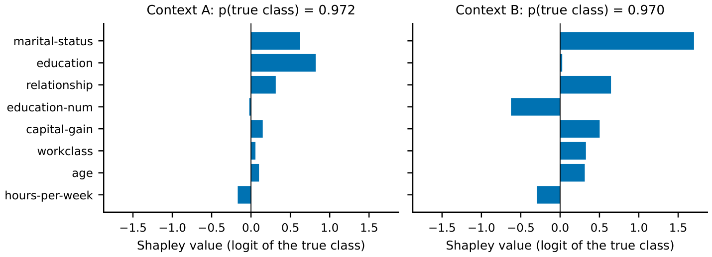
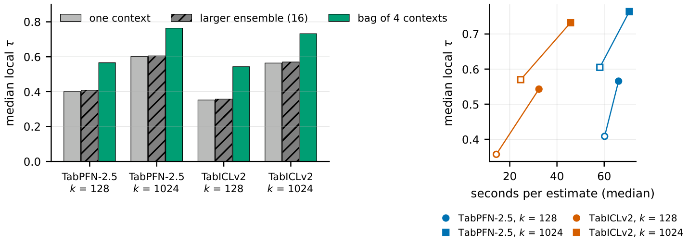
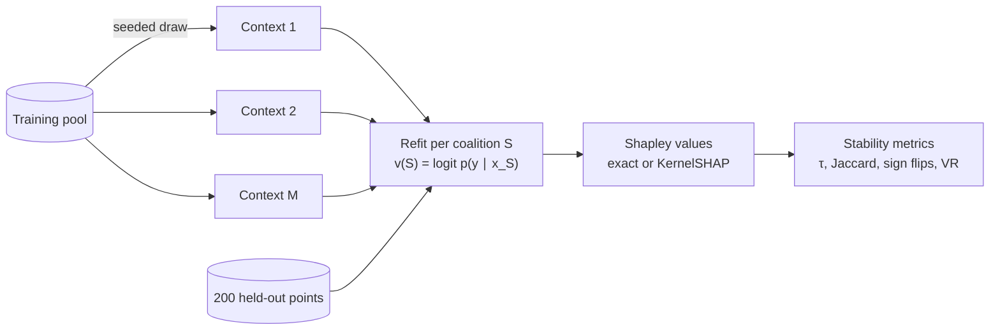

<div align="center">


<h3>Shapley explanations of tabular foundation models depend on the context sample</h3>

[](https://github.com/Tejo0507/tfm-xai-stability/actions/workflows/tests.yml)
[](https://github.com/Tejo0507/tfm-xai-stability/releases/latest)
[](https://www.python.org/)
[](https://pytorch.org/)
[](LICENSE)

[Key findings](#key-findings) •
[Installation](#installation) •
[Quickstart](#quickstart) •
[Reproducing the results](#reproducing-the-results) •
[Method](#method) •
[Citation](#citation)

</div>

---

Tabular foundation models (TFMs) such as **TabPFN** and **TabICL** predict by conditioning a frozen network on a set of labelled rows, the *context*. When a dataset is larger than the context, the rows are sampled at random, so every explanation of a TFM prediction is an explanation of the pair *(network, context)*.

`tfmxai` measures how much Shapley-value explanations change when **only the context changes**. It explains TabPFN-2.5, TabICLv2, XGBoost and logistic regression on exactly the same rows, separates context variance from model-seed and estimator noise, and compares the attributions with ground-truth Shapley values on synthetic data.

<p align="center">
  
  <br>
  <sub>One test point from <i>adult</i>, explained by TabPFN-2.5 under two random 512-row contexts. The prediction barely moves (0.972 vs. 0.970); the explanation does not. This pair is an extreme case; the median rank agreement in this setting is τ = 0.58.</sub>
</p>

## Key findings

Across 16 OpenML classification datasets, 4 models and contexts of 128 to 1024 rows (5,598 runs in total):

- **The context dominates model randomness.** The variance of an attribution across contexts is 6–250 times its variance across model seeds, a standard deviation 2.5–16 times as large.
- **Agreeing predictions do not mean agreeing explanations.** At 1024 rows, two random contexts name the same top feature in only 63–65% of cases, and only slightly more often when their predictions almost coincide.
- **TFMs sit between the baselines.** Their explanations are more stable than those of default XGBoost and less stable than those of logistic regression. On six datasets a regularised XGBoost closes most of the first gap.
- **The error is mostly variance, not bias.** On synthetic data with known population Shapley values, most of the squared error of a single-context explanation is variance across contexts. Averaging ten contexts raises rank agreement with the true values from τ = 0.70 to about 0.88.
- **Average contexts, not ensemble members.** A 16-member internal ensemble barely helps, while averaging four contexts raises local τ by 0.16–0.19.

<p align="center">
  
  <br>
  <sub>Left: a larger internal ensemble leaves stability unchanged, while a bag of four contexts raises it. Right: the same gain plotted against compute.</sub>
</p>

**In practice:** report the spread of attributions across several contexts, and prefer coarser statements, such as the top feature or the importance of a group of correlated features, over a full ranking from a single context.

## Installation

| Requirement | Note |
|---|---|
| Python | 3.12 |
| GPU | NVIDIA GPU with CUDA for TabPFN and TabICL (developed on a 6 GB RTX 4050 Laptop GPU). XGBoost, logistic regression and the unit tests run on the CPU |
| PyTorch | CUDA 12.8 wheel (`cu128`) |
| Other packages | Pinned in [`requirements.txt`](requirements.txt) |

With [uv](https://docs.astral.sh/uv/):

```bash
git clone https://github.com/Tejo0507/tfm-xai-stability.git
cd tfm-xai-stability
uv venv --python 3.12 .venv
uv pip install torch --index-url https://download.pytorch.org/whl/cu128
uv pip install -r requirements.txt -e .
```

<details>
<summary>With pip</summary>

```bash
python -m venv .venv
# Windows: .venv\Scripts\activate    Linux/macOS: source .venv/bin/activate
pip install torch --index-url https://download.pytorch.org/whl/cu128
pip install -r requirements.txt -e .
```

</details>

<details>
<summary>Cache locations and TabPFN-2.5 access</summary>

Copy [`.env.example`](.env.example) to `.env` to choose where model weights, Hugging Face downloads and OpenML datasets are cached. `tfmxai` loads `.env` on import, before the model packages read their settings; variables already set in the environment take precedence.

The TabPFN-2.5 weights need a one-time license acceptance with a Prior Labs account. On Windows the login built into `tabpfn` fails before the browser can hand back the token, so use the bundled script, which saves the token to `~/.cache/tabpfn/auth_token`:

```bash
python scripts/tabpfn_login.py
```

TabICLv2 and TabPFN v2 download their weights from Hugging Face without a login.

</details>

## Quickstart

```bash
python -m pytest -q                                          # unit tests, no GPU needed
python -m tfmxai.timing --config configs/pilot.yaml --probe 8  # estimate the cost first
python -m tfmxai.run --config configs/pilot.yaml               # 3-dataset pilot
python -m tfmxai.summarize --results results/pilot             # stability metrics per cell
```

`summarize` writes `results/pilot/summary.csv` with one row per (dataset, model, context size): local and global Kendall τ, top-3 Jaccard, sign-flip rate, the variance components and the variance ratio.

## Reproducing the results

> [!TIP]
> Every run behind the findings above is attached to the [latest release](https://github.com/Tejo0507/tfm-xai-stability/releases/latest). Unzip it into `results/` and go straight to [step 4](#4-analysis), without a GPU.

### 1. Main grid

Run the GPU and CPU models as two parallel processes. Both can be stopped and resumed at any time:

```bash
python -m tfmxai.run --config configs/main.yaml --models tabpfn_v2_5 tabicl_v2 --hours 6
python -m tfmxai.run --config configs/main.yaml --models xgboost logreg --hours 6
python -m tfmxai.summarize --results results/main
```

| Behaviour | Detail |
|---|---|
| **Resumable** | Finished runs are skipped. Stop with `Ctrl+C` or `--hours`, then rerun the same command |
| **Crash-safe** | Each result is written to a temporary file and renamed, so an interrupted write never looks finished |
| **Balanced at any stopping point** | Runs are ordered context by context across datasets, so every dataset always has the same number of contexts |
| **Laptop-friendly** | On Windows the process keeps the system awake while it runs |

### 2. Synthetic data with ground truth

```bash
python -m tfmxai.run --config configs/synthetic.yaml
python -m tfmxai.summarize --results results/synthetic
python -m tfmxai.oracle_analysis --results results/synthetic
```

`oracle_analysis` splits the error against the true Shapley values into bias and context variance, and checks whether context-bagged intervals cover the truth.

### 3. Ablations

Each ablation has its own configuration and results directory, with the same contexts and explained points as the main grid:

| Config | Varies |
|---|---|
| `ablation_ensemble1.yaml`, `ablation_ensemble16.yaml` | TFM internal ensemble size (main grid: 4) |
| `ablation_version.yaml` | TabPFN v2 instead of TabPFN-2.5 |
| `ablation_stratified.yaml` | Class-stratified context sampling |
| `ablation_grouped.yaml` | Shapley values over groups of features with \|Spearman ρ\| > 0.7 |
| `ablation_xgb_shallow.yaml` | A regularised, shallower XGBoost |

```bash
python -m tfmxai.run --config configs/ablation_ensemble16.yaml --models tabpfn_v2_5
```

### 4. Analysis

```bash
python -m tfmxai.analysis --results results/main          # hypothesis tests, figures, report.md
python -m tfmxai.ablations --main results/main            # every finished ablation vs. the main grid
python -m tfmxai.robustness --main results/main --synthetic results/synthetic
python -m tfmxai.paper_assets --main results/main         # all figures and LaTeX tables
```

Outputs go to `results/main/analysis/` and `results/paper_assets/`. Every number in the figures and tables is computed from the run files.

<details>
<summary>Command-line flags</summary>

| Flag | Script | Purpose |
|---|---|---|
| `--config PATH` | `run`, `timing` | Experiment configuration (required) |
| `--models M [M ...]` | `run`, `timing` | Run a subset of the configured models |
| `--datasets D [D ...]` | `run` | Run a subset of the configured datasets |
| `--hours H` | `run` | Stop cleanly after *H* hours |
| `--probe N` | `timing` | Coalitions timed per cell (default 12) |
| `--results DIR` | `summarize`, `analysis`, `oracle_analysis` | Results directory to read |

</details>

## Method



**Value function.** For a coalition of features $S$, the model is refit on the context restricted to the columns in $S$, and

$$
v(S) = \operatorname{logit}\, p\!\left(y_{\text{true}} \mid x_S;\ \text{context}_S\right), \qquad v(\varnothing) = \operatorname{logit}\, \hat\pi_{y}^{\text{context}}
$$

where $\hat\pi$ is the Laplace-smoothed class prior of the context. For a TFM, a refit is a new in-context forward pass. The definition is the same for every model, so differences in stability come from the models and not from the explainer.

**Shapley estimation.** For $d \le 8$ all $2^d$ coalitions are evaluated and the Shapley values are exact. Otherwise paired KernelSHAP is used with 512 coalitions and an exact efficiency constraint.

**Variance decomposition.** Every context gets one run. The first three contexts are rerun with a second model seed and, for KernelSHAP, a second explainer seed. This separates

| Component | Meaning |
|---|---|
| `var_context` | variation across context draws, the effect under study |
| `var_seed` | the model's own randomness, such as TFM ensemble shuffles |
| `var_explainer` | KernelSHAP sampling noise |

and gives the variance ratio `VR = var_context / var_seed`.

<details>
<summary>What is implemented</summary>

| Area | Module |
|---|---|
| **Models**: TabPFN v2 and 2.5, TabICLv2, XGBoost, random forest and L2 logistic regression behind one factory | `models.py` |
| **Value function**: one refit value function for every model | `values.py` |
| **Shapley estimation**: exact enumeration, or paired KernelSHAP with coalitions shared across explained points | `shapley.py` |
| **Grouped Shapley values** over correlated features | `groups.py` |
| **Data**: OpenML datasets with a stratified pool/explain split, and synthetic logistic data with a closed-form oracle | `data.py` |
| **Contexts**: deterministic uniform or stratified samplers seeded by (dataset, k, context), so every model sees identical rows | `contexts.py` |
| **Metrics**: local and global Kendall τ, top-3 Jaccard, sign-flip rate, variance components, prediction stability, oracle error | `metrics.py` |
| **Runner**: resumable grid runner with atomic writes and a time limit | `run.py` |
| **Analysis**: hypothesis tests, ablations, oracle analysis, robustness checks, figures and tables | `analysis.py`, `ablations.py`, `oracle_analysis.py`, `robustness.py`, `paper_assets.py` |

</details>

<details>
<summary>Configuration</summary>

Experiment configurations are YAML files in [`configs/`](configs). The main grid:

| Key | Main grid | Meaning |
|---|---|---|
| `datasets` | `configs/datasets.yaml` | Dataset list (OpenML IDs, or synthetic `d` and `rho`) |
| `models` | `tabpfn_v2_5, tabicl_v2, xgboost, logreg` | Models to explain |
| `k` | `128, 512, 1024` | Context sizes; sizes larger than a dataset's pool are skipped |
| `n_contexts` | `10` | Context draws per (dataset, model, k) |
| `model_seeds` | `[0, 1]` | Model seeds; seeds after the first run only on replicate contexts |
| `explainer_seeds` | `[0, 1]` | KernelSHAP seeds; seeds after the first run only on replicate contexts |
| `replicate_contexts` | `3` | Number of leading contexts that get replicate runs |
| `sampling` | `uniform` | Context sampler: `uniform` or `stratified` |
| `grouping` | not set | Optional `{threshold: t}`: players become groups of features with \|Spearman ρ\| > t |
| `n_explain` | `200` | Held-out points explained per dataset |
| `n_estimators` | `4` | Internal ensemble size of TabPFN and TabICL |
| `sv.exact_if_d_le` | `8` | Use exact Shapley values when *d* is at most this |
| `sv.budget` | `512` | KernelSHAP coalition budget |
| `device` | `cuda` | Device for TabPFN and TabICL |
| `results_dir` | `results/main` | Output directory |

</details>

<details>
<summary>Datasets</summary>

Pool size is the number of rows available for contexts after 200 points are held out for explanation. Classes with fewer than 20 instances are dropped.

| Dataset | OpenML ID | Pool size | Features | Classes |
|---|---:|---:|---:|---:|
| bank-marketing | 1461 | 45,011 | 16 | 2 |
| adult | 1590 | 48,642 | 14 | 2 |
| phoneme | 1489 | 5,204 | 5 | 2 |
| electricity | 151 | 45,112 | 8 | 2 |
| eeg-eye-state | 1471 | 14,780 | 14 | 2 |
| wilt | 40983 | 4,639 | 5 | 2 |
| churn | 40701 | 4,800 | 20 | 2 |
| magic-telescope | 1120 | 18,820 | 10 | 2 |
| mozilla4 | 1046 | 15,345 | 5 | 2 |
| pendigits | 32 | 10,792 | 16 | 10 |
| japanese-vowels | 375 | 9,761 | 14 | 9 |
| segment | 40984 | 2,110 | 16 | 7 |
| wine-quality-white | 40498 | 4,693 | 11 | 6 |
| page-blocks | 30 | 5,273 | 10 | 5 |
| nursery | 26 | 12,758 | 8 | 4 |
| jungle-chess | 41027 | 44,619 | 6 | 3 |

</details>

<details>
<summary>Output files</summary>

```text
results/<experiment>/
├── raw/<dataset>/<model>/k<k>/c<ctx>_s<seed>_e<eseed>.npz   # one file per run
├── raw/<dataset>/oracle.npz                                # synthetic datasets only
├── timing_<models>.csv                                     # wall time per run
├── last_config.json                                        # resolved configuration
└── summary.csv                                             # written by tfmxai.summarize
```

| File | Contents |
|---|---|
| Run `.npz` | `phi` [n_explain, players] Shapley values; `v_full` [n_explain] full-model true-class logits; `ctx_idx` [k] context row indices; `groups` [d] player of each feature; `exact`; `seconds` |
| `oracle.npz` | Ground-truth `phi` and `v_full` from the oracle value function |
| `summary.csv` | One row per (dataset, model, k): `tau_local`, `tau_global`, `jaccard_top3`, `sign_flip`, `var_context`, `var_seed`, `var_explainer`, `vr`, `logloss_mean`, `logloss_sd_ctx`, `p_true_sd_point`, `sec_per_run`, and `oracle_tau` / `oracle_mae` on synthetic data |

</details>

<details>
<summary>Repository layout</summary>

```text
tfm-xai-stability/
├── configs/          # experiment grids, ablations and dataset lists
├── docs/assets/      # banner and README figures
├── scripts/          # TabPFN login, reproducibility check, constant-coalition audit
├── src/tfmxai/       # the package: data, models, Shapley estimation, metrics, runner, analysis
└── tests/            # unit tests run by GitHub Actions
```

</details>

## Testing

```bash
python -m pytest -q
```

The tests check exact Shapley values against the permutation definition, KernelSHAP efficiency and accuracy, deterministic context sampling, the refit value function against the synthetic oracle, the vectorised Kendall τ against SciPy, the variance-ratio bootstrap and paired tests, grouped Shapley values, and the bias–variance split used with the oracle. GitHub Actions runs them on every push to `main` and on every pull request.

## Citation

If you use this code or its results, please cite:

```bibtex
@software{mvs2026tfmxai,
  author  = {M V S, Tejo Sridhar},
  title   = {Shapley Explanations of Tabular Foundation Models Depend on the Context Sample},
  year    = {2026},
  version = {1.0.0},
  url     = {https://github.com/Tejo0507/tfm-xai-stability}
}
```

GitHub's **Cite this repository** button gives the same entry from [`CITATION.cff`](CITATION.cff).

## Acknowledgements

This project builds on [TabPFN](https://github.com/PriorLabs/TabPFN), [TabICL](https://github.com/soda-inria/tabicl), [XGBoost](https://github.com/dmlc/xgboost), [scikit-learn](https://scikit-learn.org) and [shapiq](https://github.com/mmschlk/shapiq). The datasets come from [OpenML](https://www.openml.org).

## License

The code is released under the [Apache License 2.0](LICENSE). Model weights downloaded at runtime (TabPFN, TabICL) are distributed by their providers under their own licenses.

<div align="center">

**Tejo Sridhar M V S** · [@Tejo0507](https://github.com/Tejo0507) · [ORCID 0009-0007-5023-1092](https://orcid.org/0009-0007-5023-1092)

</div>
